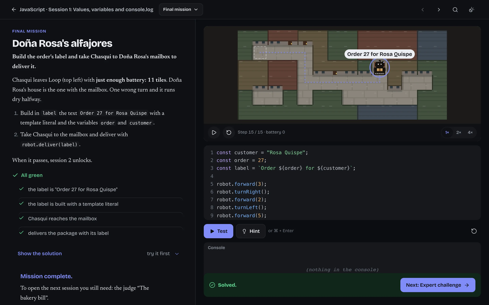
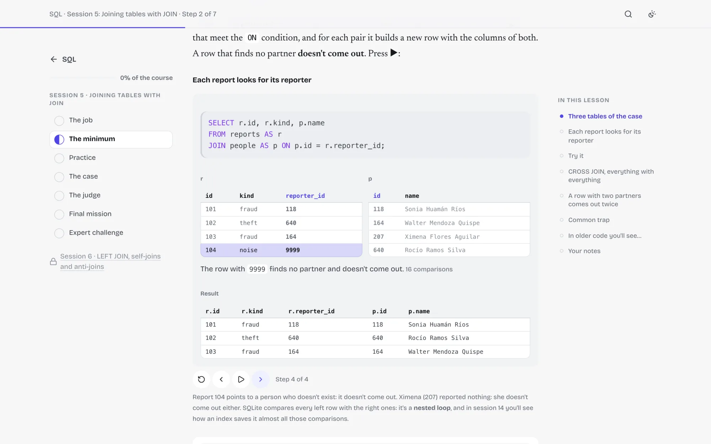
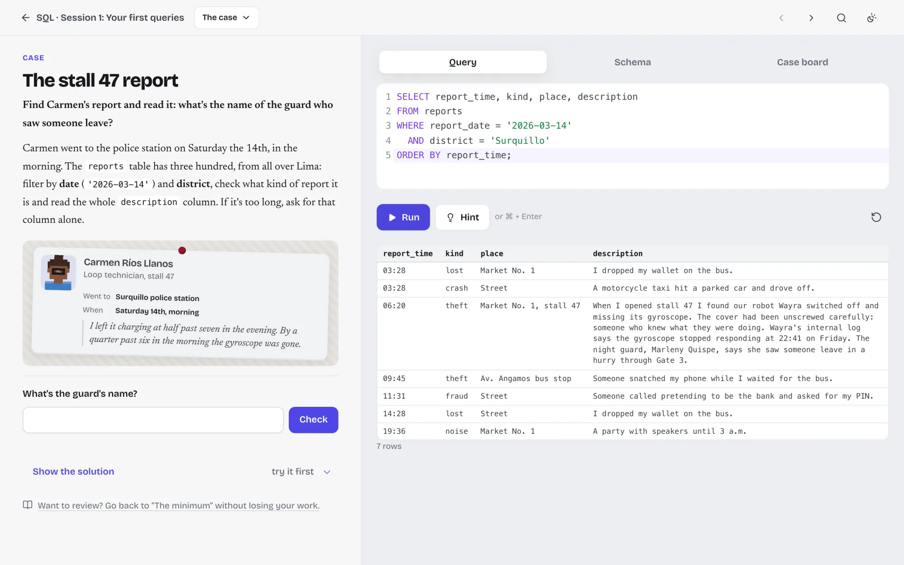
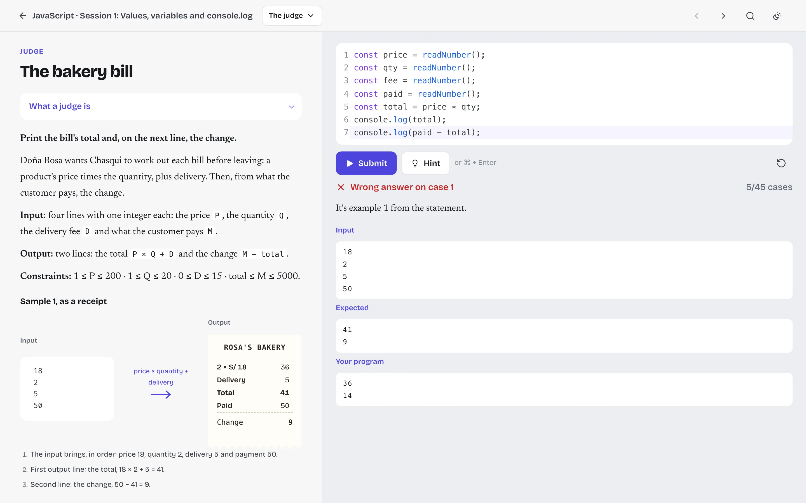
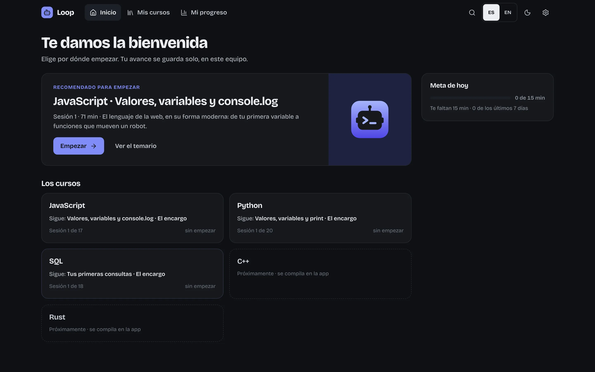
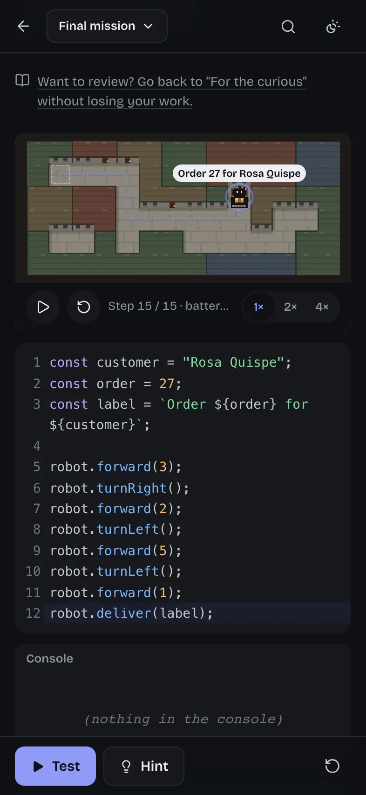

<div align="center">

# Loop · Programming Courses

**Learn JavaScript, Python and SQL by programming a robot and cracking cases in Lima, as a website and an offline desktop app.**

[](https://rayveraimar.github.io/programming-courses/)
[](https://github.com/RayverAimar/programming-courses/releases/latest)
[](#whats-inside)
[](#whats-inside)
[](#what-it-does)
[](package.json)

<sub>Every session a customer brings a job to Loop, a robot workshop in Barranco, Lima, and the learner's code is what gets it done. Everything runs in the page: no account, no server, progress in a local SQLite file.</sub>

<br>



</div>

---

## Screenshots

| | |
|:--|:--|
|  |  |
| **Concepts are drawn.** Here a `JOIN` pairs rows one by one; step through it or press play. | **SQL cases.** Query Lima's case files to follow a trail of reports, phones and payments. |
|  |  |
| **The judge** grades in competitive-programming style and shows the first failing case. | **Spanish and English**, light and dark. The home lists the courses and what is next. |

<p align="center"></p>

## Download

The app works offline, with Python and SQL included. Get it from the [latest release](https://github.com/RayverAimar/programming-courses/releases/latest):

| System | File |
|---|---|
| macOS, Apple Silicon | [`loop-mac-arm64.dmg`](https://github.com/RayverAimar/programming-courses/releases/latest/download/loop-mac-arm64.dmg) |
| macOS, Intel | [`loop-mac-x64.dmg`](https://github.com/RayverAimar/programming-courses/releases/latest/download/loop-mac-x64.dmg) |
| Windows | [`loop-win-x64-setup.exe`](https://github.com/RayverAimar/programming-courses/releases/latest/download/loop-win-x64-setup.exe) (installer) · [`loop-win-x64-portable.exe`](https://github.com/RayverAimar/programming-courses/releases/latest/download/loop-win-x64-portable.exe) (portable) |
| Linux | [`loop-linux-x86_64.AppImage`](https://github.com/RayverAimar/programming-courses/releases/latest/download/loop-linux-x86_64.AppImage) · [`loop-linux-amd64.deb`](https://github.com/RayverAimar/programming-courses/releases/latest/download/loop-linux-amd64.deb) |

The app is not signed. On macOS, open it once and then use System Settings › Privacy & Security ›
Open Anyway. On Windows, SmartScreen › More info › Run anyway. Or use it on the web:
[rayveraimar.github.io/programming-courses](https://rayveraimar.github.io/programming-courses/).

## What's inside

| Course | Sessions | The story |
|---|---:|---|
| JavaScript | 17 | The robot is Chasqui, in Barranco. |
| Python | 20 | From values to asyncio, the data model and performance. The robot is Quilla, at Loop's branch in Chucuito, Callao. Python runs in the page with [Pyodide](https://pyodide.org). |
| SQL | 18 | Lima's case files: one growing database and five cases (Wayra's gyroscope, the sensor room sabotage, the payments ring, the 1998 cold case and the market registry), with SQLite running in the page. |

C++ and Rust are listed as coming.

## What it does

- **A session has a shape.** The job, the minimum you need, practice, a case, a judge problem, a
  final mission and an expert challenge. The judge and the mission together unlock the next session
  (a locked session can still be read).
- **A judge.** Competitive-programming style: stdout or function mode, seeded cases, verdicts that
  show the failing input, the expected output and yours.
- **An editor** (CodeMirror 6) with autocomplete and signature help for the robot, the language and
  the SQL schema, running in a sandboxed Web Worker with time limits.
- **Visuals.** A pixel-art robot world with step-by-step playback, case scenes and boards, figures
  and animations of how things run inside, such as a `JOIN` pairing rows.
- **Progress** in SQLite (sql.js): steps read, exercises passed and every attempt, code in progress,
  notes, study time and a review queue. IndexedDB on the web, a file in the app; export and import.
- Spanish and English, light and dark, search, and everything served locally: fonts, icons, the
  editor, Pyodide and sql.js. The app and the site share one platform (`platform/`).

## Development

```bash
pnpm install
node scripts/serve.mjs     # http://localhost:4400 — rebuilds and reloads on every save
node scripts/build.mjs     # dist/: the website (GitHub Pages) and what the desktop app loads
node scripts/verify.mjs    # runs every exercise in both languages
pnpm app                   # the desktop app from this folder
pnpm smoke                 # drives the app: lesson, exercise, quit, relaunch, progress kept
pnpm dist:mac              # installers in release/ (also dist:win, dist:linux)
```

The site and the app share one platform (`platform/`, see [docs/platform.md](docs/platform.md)):
five screens (Inicio, Temario, Lección, Taller, Mi progreso), progress in a SQLite database
(IndexedDB on the web, a file in the app, export/import between them), and everything served
locally: fonts, icons, the editor, Pyodide and sql.js (vendored at build time, checked against the
lockfile's hash). `dist/` loads a small shell and then one JSON file per session on demand.

`verify.mjs` checks, with the same harness the page uses, that every solution passes its tests,
every starter fails them, every "predict" answer is what Node really prints, every case solution
prints its answer, every runnable example runs, and every judge is sound (deterministic cases,
reference accepted, starter and plausible wrong solutions rejected, same data in both languages),
no case starter already prints its answer, and code uses the page's language; it warns about a
case or judge without a visual. Run it after editing content. For Python it runs the same runner
the page uses (Pyodide from npm, in a worker thread) and compares "predict" answers and runnable
examples against the local CPython (`python3`). Pass a filter to check less: `node
scripts/verify.mjs py` or `node scripts/verify.mjs py/07`.

### Layout

```
content/js/NN-slug.md          a session, in Spanish (the original)
content/js/_modern.yml         modern-vs-legacy notes and MDN links, one entry per feature
content/i18n/en/js/NN-slug.md  its English translation, same file name and exercise ids
content/py/, content/i18n/en/py/  the same for the Python track
content/sql/_cases.yml         Lima's case files: places, clues and people, shared by the SQL sessions
content/sql/, content/i18n/en/sql/  the SQL track, same shape
src/sql/                       the SQL world (schema, seeded data, case plots), engine, scenes and editor completion
src/runner/sqlworker.js        the SQL sandbox in the page (a Web Worker with sql.js)
src/runner/py/taller.py        the Python runner: robot, judge, virtual-time asyncio, tracing
src/runner/pybridge.js         boots Pyodide and the runner, shared by the page and the scripts
src/runner/pyworker.js         the Python sandbox in the page (a Web Worker with Pyodide)
src/runner/pyclient.js         queue and watchdog for the Python worker (4 s, 3 s per judge case)
src/world/engine.js            the grid, the robot and its commands (no DOM)
src/world/render.js            pixel-art sprites, canvas drawing and step-by-step playback
src/runner/harness.js          runs a program against an exercise's tests
src/runner/judge.js            the judge: stdout and function modes, seeded cases, verdicts
src/runner/worker.js           the sandbox: a Web Worker, killed after 2 s (1 s per judge case)
src/editor.js                  CodeMirror 6, bundled by esbuild
src/editor/complete.js         autocomplete and signature help, from src/api/*.json
src/api/                       the API data: robot members, readers, server, JavaScript docs
src/world/server.js            the simulated server on a virtual clock (async sessions)
src/visuals.js                 scenes, case boards, figures and traced concept animations
src/exercise.js                the exercise component (inline in a lesson, split in the Taller)
src/adapter.js                 how sessions render on the platform: lessons, workshop, legacy import
src/course.css                 styles for exercises, the judge, the robot and the visuals
platform/                      the shared core: screens, components, database, build, desktop app
site.config.json               the site's name, storage prefix, GitHub repo, installer names
build/icon.svg                 the app icon (all sizes are generated from it)
scripts/                       build, dev server, verification, Pyodide vendoring, app smoke test
```

### Docs

- [docs/platform.md](docs/platform.md): the platform: what is core, how content plugs in, the database, build and release.
- [docs/components.md](docs/components.md): the component library (live at `#/_componentes`).
- [docs/content.md](docs/content.md): how a session is written, the modern-JS boxes, translations.
- [docs/python.md](docs/python.md): the Python track: runner, judge, story and the 20-session plan.
- [docs/sql.md](docs/sql.md): the SQL track: the engine, Lima's case files, the world's data and how SQL sessions are written.
- [docs/exercises.md](docs/exercises.md): the exercise blocks, tests, worlds and scenarios.
- [docs/robot-api.md](docs/robot-api.md): the robot, the simulated server, helpers, session config and autocomplete.
- [docs/visuals.md](docs/visuals.md): scenes, case boards, figures and concept animations; the "understood at a glance" rule.

### Progress

Progress lives in a SQLite database (schema in [docs/platform.md](docs/platform.md)): steps read,
exercises passed and every attempt, code in progress per language, notes, study time, the review
queue and finished courses. Progress kept in `localStorage` by earlier versions is imported once.
A session opens when the previous session's final mission and its judges pass; a locked session
can still be looked at. On localhost the syllabus also offers a "skip the lock (test mode)" button.
